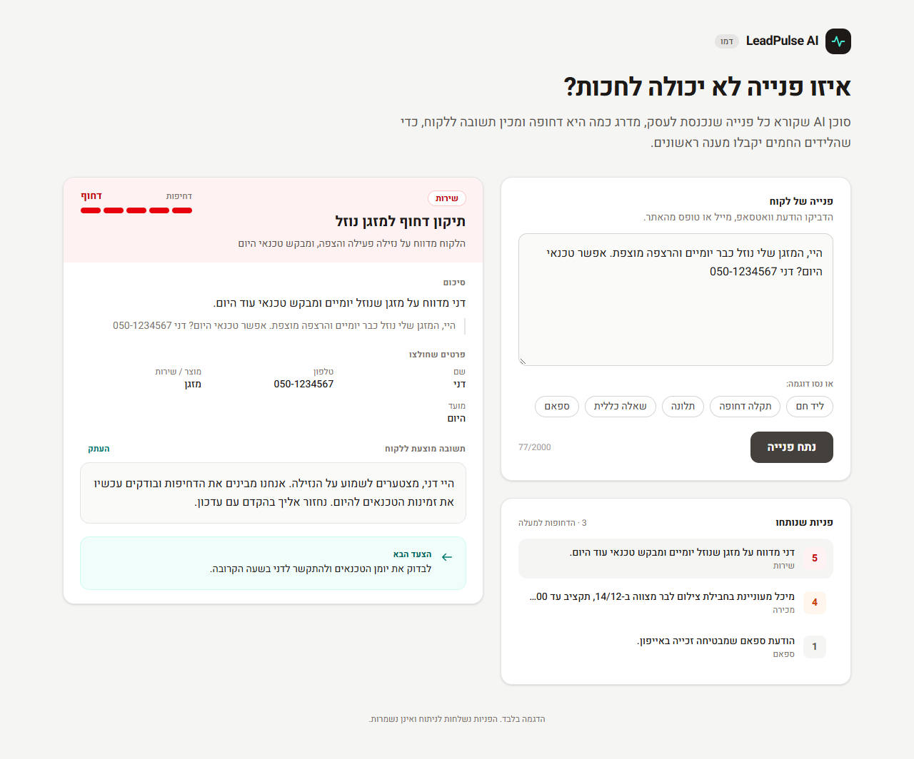
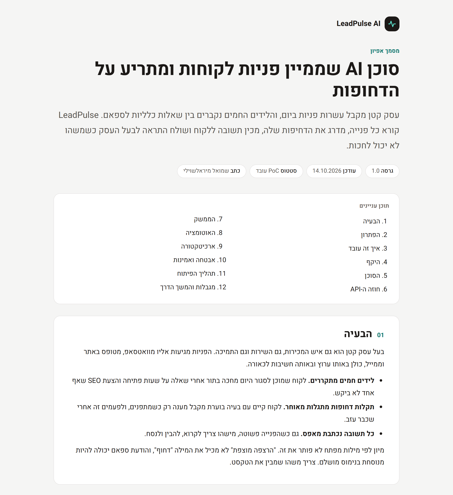
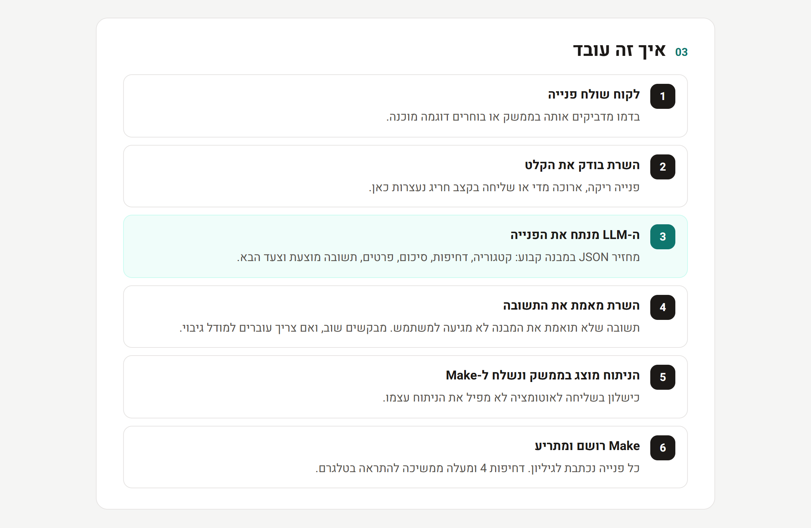

<div dir="rtl">

# LeadPulse AI

סוכן AI שממיין פניות לקוחות ומתריע על הדחופות.

עסק קטן מקבל עשרות פניות ביום, והלידים החמים נקברים בין שאלות כלליות לספאם. LeadPulse קורא כל פנייה, מדרג את הדחיפות שלה מ-1 עד 5, מכין תשובה ללקוח, רושם אותה בגיליון מעקב ושולח התראה לטלפון של בעל העסק כשמשהו לא יכול לחכות.



## מה הסוכן מחזיר

| שדה | למה זה משמש |
|---|---|
| כוונה וקטגוריה | מכירה, שירות, תמיכה, תלונה, מידע כללי או ספאם |
| דחיפות 1–5 עם נימוק | סדר הטיפול, ולמה הסוכן החליט כך |
| סיכום בשורה אחת | לדעת במה מדובר בלי לקרוא את כל ההודעה |
| פרטים שחולצו | שם, טלפון, מוצר, תקציב ומועד, רק אם הופיעו בפנייה |
| תשובה מוצעת | מוכנה להעתקה ושליחה |
| הצעד הבא | מה בעל העסק צריך לעשות עכשיו |

## איך זה עובד

1. לקוח שולח פנייה בטקסט חופשי.
2. השרת בודק את הקלט ושולח אותו ל-LLM עם פרומפט וסכמת פלט קבועה.
3. השרת מאמת את תשובת המודל. תשובה לא תקינה לא מגיעה למשתמש.
4. הניתוח מוצג בממשק ונשלח ל-webhook של Make.
5. Make מוסיף שורה ל-Google Sheets, ואם הדחיפות 4 ומעלה שולח התראה בטלגרם.

ה-AI הוא המוח: הוא מבין את הטקסט ומחליט. האוטומציה היא הידיים: היא רושמת, מסננת ומתריעה.

## מסמך האפיון

הבעיה, הפתרון, ההחלטות שמאחורי הסוכן, חוזה ה-API, מה נבדק ומה נשאר בחוץ מתוארים במסמך האפיון: [`public/spec.html`](public/spec.html). הוא מוגש יחד עם האפליקציה בכתובת `/spec.html`.





## טכנולוגיות

| שכבה | טכנולוגיה |
|---|---|
| ממשק | React, Vite, Tailwind CSS |
| שרת | Node.js כפונקציית Serverless ב-Vercel |
| LLM | Gemini, עם מודל גיבוי |
| אוטומציה | Make, Google Sheets, Telegram |
| בדיקות | Vitest |

## הרצה מקומית

דרוש Node.js 20 ומעלה.

<div dir="ltr">

```bash
npm install
cp .env.example .env    # then fill in GEMINI_API_KEY
npm run dev             # http://localhost:5173
npm test
```

</div>

מפתח Gemini חינמי מוציאים ב-[Google AI Studio](https://aistudio.google.com/apikey). הפקודה `npm run dev` מריצה גם את הממשק וגם את פונקציית השרת, בלי צורך ב-Vercel CLI.

### משתני סביבה

| משתנה | חובה | תיאור |
|---|---|---|
| `GEMINI_API_KEY` | כן | מפתח ל-Gemini API |
| `GEMINI_MODEL` | לא | מודל אחר במקום ברירת המחדל |
| `AUTOMATION_WEBHOOK_URL` | לא | כתובת ה-webhook של Make. בלעדיה האפליקציה עובדת בלי אוטומציה |

## חיבור האוטומציה

1. ב-[Make](https://www.make.com) יוצרים תרחיש חדש ומייבאים את [`automation/make-blueprint.json`](automation/make-blueprint.json).
2. מחברים חשבון Google ובוחרים גיליון עם העמודות: זמן, דחיפות, קטגוריה, סיכום, שם, טלפון, פנייה.
3. מחברים בוט טלגרם וממלאים את ה-Chat ID שאליו יישלחו ההתראות.
4. מעתיקים את כתובת ה-webhook למשתנה `AUTOMATION_WEBHOOK_URL` ומפעילים את התרחיש.

השרת רק שולח JSON לכתובת, כך שאפשר להחליף את Make ב-n8n או בכל כלי אחר בלי לשנות קוד.

## מבנה הפרויקט

<div dir="ltr">

```
api/
  analyze-lead.js     the endpoint: validate, call the LLM, verify, notify
  _lib/
    prompt.js         system prompt and output schema
    llm.js            the only file that knows the LLM provider
    validate.js       input and output validation
    rateLimit.js      per-IP request limit
    webhook.js        forwards results to the automation
src/                  React UI
automation/           Make scenario blueprint
tests/                unit tests
public/spec.html      the spec
```

</div>

## תהליך הפיתוח

הפרויקט נבנה בחמישה שלבים, וכל אחד מהם נסגר ב-commit משלו:

1. **אפיון ושלד** – מסמך אפיון, הקמת הפרויקט, ונקודת קצה שמחזירה תשובה קבועה.
2. **ליבת הסוכן** – פרומפט, קריאה ל-LLM, אימות, הגבלת קצב ובדיקות.
3. **ממשק** – הזנה, כרטיס תוצאה, היסטוריה ומצבי קצה.
4. **אוטומציה** – webhook, גיליון מעקב והתראה בטלגרם.
5. **פריסה ותיעוד**.

הקוד נכתב בעבודה משותפת עם Claude Code.

## מגבלות ידועות

- הדמו רץ על המכסה החינמית של Gemini, שבשעות עומס דוחה חלק מהבקשות. מודל הגיבוי מצמצם את זה אבל לא מבטל.
- הגבלת הקצב נשמרת בזיכרון של הפונקציה ומתאפסת כשהיא עולה מחדש.
- הסוכן לא מכיר את מחירי העסק או את שעות הפתיחה שלו, ולכן התשובות שלו זהירות.

הצעדים להפיכת ה-PoC למוצר מפורטים בסוף מסמך האפיון.

---

שמואל מיראלשוילי

</div>
